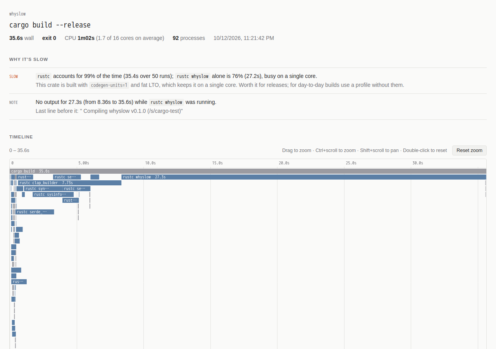

# whyslow

**Run any command and see where the time went.**

Put `whyslow` in front of a build, a test suite, a deploy script, anything that spawns processes.
It records every process the command starts, how long each one ran, how much CPU it used and
when it was just waiting, then tells you what is actually slow and what to do about it.

```
whyslow npm run build
whyslow make -j8
whyslow --html cargo build --release
```

No config, no instrumentation, works with any language or tool.

## What it looks like

This is whyslow on its own release build:

```
────────────────────────────────────────────────────────────────────────────────────────── whyslow
  cargo build --release
  35.6s  ·  exit 0  CPU 1m02s (1.7 of 16 cores)  92 processes

  TIMELINE
                                 0s                10s               20s                30s
  cargo build             35.6s  █████████████████████████████████████████████████████████████████
  ├─ rustc serde_core     2.89s   █████
  ├─ rustc libc           1.24s   ██
  ├─ rustc clap_builder   7.73s   ██████████████
  ├─ rustc syn            2.87s    █████
  ├─ rustc sysinfo        3.07s     ██████
  ├─ rustc serde_json     2.08s        ████
  ├─ rustc serde_derive   2.09s         ████
  └─ rustc whyslow        27.3s                 ██████████████████████████████████████████████████
                                 █ busy  ░ idle (nothing under it using CPU)   +83 shorter processes not shown

  WHERE THE TIME WENT
  tool                    time  share                          runs       cpu  peak mem
  rustc                  35.4s    99%  ■■■■■■■■■■■■■■■■■■■■     ×50     1m01s    326 MB
  other                  204ms     1%  (5 more)

  WHY IT'S SLOW
  ▲ `rustc` accounts for 99% of the time (35.4s over 50 runs); `rustc whyslow` alone is 76% (27.2s),
    busy on a single core.
    This crate is built with `codegen-units=1` and fat LTO, which keeps it on a single core.
    Worth it for releases; for day-to-day builds use a profile without them.
  · No output for 27.3s (from 8.36s to 35.6s) while `rustc whyslow` was running.
```

Three quarters of the build is one crate on one core, because of two lines in `Cargo.toml`.
That is the kind of answer whyslow is for.

With `--html` you also get a single-file interactive report: a zoomable flame chart of every
process, CPU usage over time, per-process details and the command's output on the same clock.

<picture>
  <source media="(prefers-color-scheme: dark)" srcset="docs/report-dark.png">
  
</picture>

## Install

Prebuilt static binaries for Linux (x86_64, arm64) and macOS are on the
[releases page](https://github.com/luuuccasss/whyslow/releases):

```sh
curl -L https://github.com/luuuccasss/whyslow/releases/latest/download/whyslow-x86_64-unknown-linux-musl.tar.gz | tar xz
sudo mv whyslow /usr/local/bin/
```

Or build it with Cargo (Rust 1.82+):

```sh
cargo install --git https://github.com/luuuccasss/whyslow
```

## Usage

```
whyslow [OPTIONS] <COMMAND>...
```

| Option | |
|---|---|
| `--html[=FILE]` | write the interactive report (default `whyslow.html`) |
| `--open` | write the report and open it in the browser |
| `--json[=FILE]` | save the raw recording, for `show` and `compare` |
| `--trace[=FILE]` | write Chrome trace events, to open in [Perfetto](https://ui.perfetto.dev) or `chrome://tracing` |
| `-q, --quiet` | hide the command's own output |
| `--rows N` | rows in the terminal timeline (default 14) |
| `--no-report` | don't print the report, only write files |
| `--backend auto\|ptrace\|poll` | how processes are observed (see below) |

whyslow exits with the command's exit code, prints the report on stderr and leaves the command's
stdout alone, so it can go anywhere in a pipeline or a CI script. Output keeps its colors and
progress bars: when you're in a terminal the command runs in a pseudo-terminal.

### Before / after

Record two runs and compare them. Here is the build above again, with LTO off and
`codegen-units = 16` (`CARGO_PROFILE_RELEASE_LTO=false CARGO_PROFILE_RELEASE_CODEGEN_UNITS=16`):

```sh
whyslow --json=before.json cargo build --release
# change something
whyslow --json=after.json cargo build --release
whyslow compare before.json after.json
```

```
  wall time          35.6s → 11.6s     -24.0s (-67%)
  cpu time           1m02s → 1m21s     +19.7s (+32%)
  processes             92 → 92

  tool         before      after      delta          runs
  rustc         35.4s      11.4s     -24.1s    -68%  ×50
```

More CPU in total, but spread over the cores: three times faster on the clock.

`whyslow show run.json` prints the report of a saved recording again, with `--html` if you want
the page.

## What it looks for

- **One step dominates.** Which tool and which single run, whether it was busy on one core,
  spread over several, or mostly waiting.
- **Steps that ran one after another** under the same script while the machine had idle cores,
  with the time you could save by running them in parallel (only when none of them already
  saturates the CPU).
- **Idle time.** A process whose whole subtree used no CPU for seconds is waiting on the network,
  the disk, a lock or a `sleep`. The timeline shows it as `░`.
- **Process storms.** Hundreds of short-lived processes of the same tool, where startup cost adds
  up.
- **The same command run twice** with the same arguments in the same directory.
- **Tool-specific fixes**, only when they apply: `tsc` without incremental builds (it reads your
  `tsconfig.json` to check), `eslint`/`prettier` without `--cache`, `jest --runInBand`, webpack's
  persistent cache, dependency installs in CI, slow linkers, `codegen-units=1`/LTO in Rust, Docker
  builds where the work happens in the daemon.
- **Silences.** The longest stretch without output and who was running during it.
- Memory peaks above 1.5 GB, and processes that outlive the command (daemons, background jobs).

Processes get readable names: `node …/node_modules/typescript/bin/tsc` is `tsc`,
`node …/npm-cli.js run build` is `npm run build`, `rustc --crate-name serde …` is `rustc serde`,
`cc -c src/main.c` is `cc main.c`.

## How it works

On Linux the command runs under `ptrace` with only process events enabled (fork, clone, exec,
exit), never syscall tracing. Every process is seen, including ones that live for a millisecond,
with its exact start and end, command line, working directory, CPU time, peak memory and disk
I/O read from `/proc` just before it exits. A sampler reads per-process CPU every 100ms for the
CPU graph and idle detection.

The "time" column comes from a sweep over the process tree: at every instant, the processes
doing the work (the ones with no running child) share the clock equally. A wrapper like
`npm run build` only gets the time it spends itself, parallel jobs split it, and the column adds
up to the wall time.

**Overhead.** CPU-bound work is unaffected (+2–3% measured). Each new process costs about 0.2ms of
extra ptrace round trips, so a script that spawns 2,000 `/bin/true` in a loop runs ~35% slower;
a typical build spawns tens to hundreds of processes and doesn't notice.

**Elsewhere** (macOS, or Linux where ptrace isn't allowed, e.g. some locked-down containers)
whyslow falls back to polling the process table every 20ms. That needs no permission but can
miss processes shorter than that, and timings are ±10ms. `--backend poll` forces it.

Things it does not see: work done by another process it didn't start (the Docker daemon, a build
server, a remote cache), and time inside a single process. For the latter, pair it with a
profiler for that one tool once whyslow has told you which one.

## Building

```sh
cargo build --release
cargo test
```

## License

MIT
